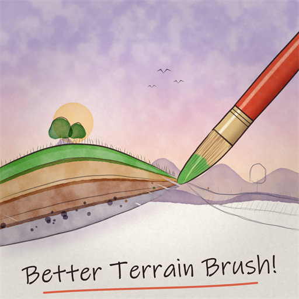

# Better Terrain Brush!

A Roblox Studio plugin with the Terrain Editor's brush tools, plus any brush shape you want. It has built-in shapes, Models or MeshParts from your place, and `.obj` / `.stl` files you upload. It also has a rotation gizmo and brushes that follow paths.

## Features

- **Brush tools**:
  - Tools: Draw (Add / Subtract), Sculpt (Grow / Erode), Smooth, Flatten (Erode / Both / Grow, optional fixed plane) and Paint / Replace.
  - Settings: Size, Height, Strength, Pivot, Snap to voxels, Plane lock (Off / Auto / Manual), Ignore water, Ignore parts and Auto material.
- **9 built-in shapes**: Sphere, Cube, Cylinder, Donut, Hollow Cylinder, Half Circle, Half Dome, U and V, with an adjustable wall thickness for the hollow ones.
- **Mesh brushes**:
  - Add any Model or MeshPart from your place.
  - Or upload an `.obj` / `.stl` file straight into the plugin's library. Library brushes work in every place.
  - Mesh brushes show a preview of exactly the shape that will be stamped.
- **Rotation**: Studio-style rotation rings (press R), X / Y / Z sliders and optional random rotation. Auto-rotate (tilt to the surface, face along the stroke) is off by default.
- **Paths**:
  - Line, circle, square, polygon and spiral, with Rise for ramps and helixes.
  - Place a path, then drag along it to draw only the part you want, or stamp the whole path in one click.
  - Paths are exact shapes at the height you place them. Following the ground is optional.
- **Custom materials**: every terrain material slot, including custom MaterialVariant slots, with texture thumbnails in the picker.
- **Accurate results**:
  - Brushes come out the size of their preview.
  - Slow Draw strokes don't pile up into towers or dig themselves down.
  - Every stroke or path is one undo step.

### Shortcuts

| Key | What it does |
| --- | --- |
| Ctrl (hold) | Subtract with Draw, Erode with Sculpt |
| Shift (hold) | Smooth while using Draw or Sculpt |
| B + drag | Change the brush size (Ctrl+B height, Shift+B strength) |
| R | Rotate the brush with handles (Enter / Esc or a click off the rings to finish) |
| Alt + click | Pick up the material under the cursor |
| Ctrl+Z | Undo the last stroke or path |

## Install

Install it from the Roblox **Creator Store** (search for "Better Terrain Brush!"), or build it from source:

1. Install [Aftman](https://github.com/LPGhatguy/aftman), then run `aftman install` in this folder to get Rojo.
2. Build the plugin into your local Plugins folder:
   - Windows: `rojo build -o "$env:LOCALAPPDATA\Roblox\Plugins\BetterTerrainBrush.rbxm"`
   - macOS: `rojo build -o ~/Documents/Roblox/Plugins/BetterTerrainBrush.rbxm`
3. Restart Studio. Studio only loads local plugins when it starts.

Open it from the **Plugins** tab with the **Terrain Brush** button.

## How it works

The code is split into small modules in [`src/`](src):

| Module | Job |
| --- | --- |
| `init.server.luau` | Entry point: starts `App` with the `plugin` object |
| `App.luau` | Tool state, strokes, paths, shortcuts, the brush library and the panel |
| `Stamp.luau` | Applies one brush stamp to terrain: reads the voxels once, works out every change, writes once |
| `Shapes.luau` | The built-in shapes as signed distance functions |
| `Voxelizer.luau` | Turns place Models / MeshParts (by raycasting) and uploaded triangles (by winding number) into voxel masks, plus their distance fields |
| `MeshImport.luau` | `.obj` and ASCII / binary `.stl` parsers |
| `Library.luau` | Brushes saved in plugin settings (run-length encoded, base64) |
| `Preview.luau`, `SurfaceMesh.luau` | The ghost preview, path dots, plane and rotation rings; preview meshes built from voxel masks |
| `Paths.luau` | Parametric paths resampled into evenly spaced stamps |
| `Materials.luau` | Reads the terrain material slots |
| `Ui.luau` | A small theme-aware widget kit for the dock panel |

Some details that might save you time if you work on terrain tools:

- **Where terrain draws its surface.** Roblox draws a voxel's surface 4 × occupancy studs out from the voxel's centre. Occupancy 0.5 sits on the voxel boundary, and a full voxel next to air reaches its neighbour's centre. To put the surface at signed distance `d` from a voxel centre (negative inside), use `occupancy = clamp(-d / 4, 0, 1)`. Carving uses `clamp(d / 4, 0, 1)`, not `1 - that`. Everything in `Stamp` works from signed distances for this reason.
- **Custom material slots.** The plugin uses `ReadVoxelChannels` / `WriteVoxelChannels` with the `SolidMaterialIndex` channel. Plugins can't call `FillBlockSlot` or `SmoothRegion`, so Smooth blurs a reconstructed signed distance instead. Blurring raw occupancy grows every surface.
- **Seams.** An empty voxel between two solids, such as a brush resting exactly on the ground, renders as a hairline crack. A small occupancy (≥ 0.05) closes it.

`App.start(plugin, host)` takes optional overrides (container, mouse, keys, file prompt), so the whole tool can be driven by a test script with a mock `plugin`.

## Contributing

Issues and pull requests are welcome. The code uses `--!strict` Luau with tabs. Please test changes in Studio on a spare baseplate before opening a pull request.

## License

Copyright (C) 2026 Phini

This program is free software: you can redistribute it and/or modify it under the terms of the GNU General Public License as published by the Free Software Foundation, either version 3 of the License, or (at your option) any later version.

This program is distributed in the hope that it will be useful, but WITHOUT ANY WARRANTY; without even the implied warranty of MERCHANTABILITY or FITNESS FOR A PARTICULAR PURPOSE. See [LICENSE](LICENSE) for the full text.
